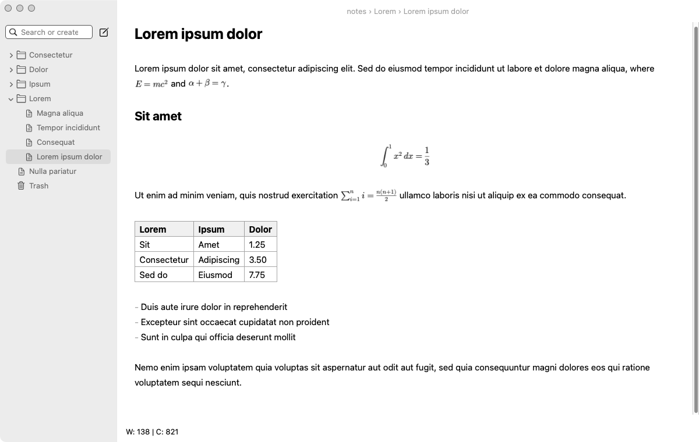

## Changes in this fork

This fork is based on FSNotes 7.6.0. Notes stay plain files on disk: only the interface changes, folders and notes work exactly as before.

- **Tree explorer.** An Obsidian-style folder/note tree replaces the two-column sidebar and notes list (Notes, Inbox, Todo, Untagged and tags are no longer shown).
  - Two levels only: top-level folders and their notes. New folders are always created at the top level; subfolders that already exist on disk are left untouched but not shown.
  - Click a folder to expand it, click a note to open it; search filters the tree.
  - Drag notes between folders, drag folders to reorder them, right-click for the usual note and folder actions.
  - **Trash** sits at the bottom: browse deleted notes, restore them (Move or drag out) or delete them forever (always confirmed).
  - `Cmd+Shift+B` shows/hides the explorer, `Esc` hides it, `Cmd+Return` jumps from the editor to the tree.
- **Private mode** (`Cmd+Shift+H`, View → Private Mode).
  - The explorer shows titles only, note previews become "...".
  - The editor shows only the line being edited; everything else (text, images, formulas) is hidden while you keep typing normally.
  - View → Private Mode Lines sets how many lines around the current one stay visible (current line only, ±1, ±2, ±3, ±5, ±10). Preview mode is not affected.
  - The History shortcut moves to `Ctrl+Cmd+H`.
- **Basic Vim mode** (View → Vim Mode).
  - Normal, Insert, Visual and Visual Line modes with a block caret and a mode indicator.
  - Motions (`h j k l w b e 0 ^ $ gg G { } f t ; ,`), operators (`d c y > <` with counts and text objects such as `iw`, `i"`, `i(`), `x s r ~ J p P o O`, `.` repeat.
  - Search with `/` and `?` (regex, case-insensitive unless the pattern has capitals), then `n` / `N`; `*` / `#` search the word under the caret.
  - `y` briefly highlights what was copied and also copies it to the system clipboard; `p` / `P` paste text copied in other apps.
  - `u` / `Ctrl-R` undo and redo one whole command (an insert session counts as one step); `Cmd+Z` works in every mode.
  - With Vim mode on, `Esc` belongs to Vim; use `Cmd+Shift+B` to hide the explorer.
- **Inline preview of LaTeX math and Markdown tables** (when "Hide Markdown syntax" is on).
  - `$…$`, `\(…\)` and `$$…$$` render with [SwiftMath](https://github.com/mgriebling/SwiftMath); tables render as a grid.
  - The line under the caret switches back to the raw Markdown for editing. Math inside code is left alone.
  - Markdown links `[text](url)` show only their text, as a clickable link.
- **Preview (`Cmd+/`) renders LaTeX reliably** (with Preview MathJax on).
  - Works in every note, not only notes with images; `$…$`, `$$…$$`, `\(…\)` and `\[…\]` reach MathJax untouched (matrices with `\\`, subscripts with `_`).
  - `$$…$$` inside a sentence stays in the sentence like in the editor; alone on its line it is centered.
  - Extensions such as `\color`, `\cancel`, `\boldsymbol` and `\ce` are bundled; a formula that still fails is shown in red while all others render.
  - Focus stays in the preview (typing no longer jumps to the hidden search field); list numbers and wide formulas no longer get cut off.
- Builds with Xcode 16.2 (newer macOS 26 APIs are compiled only with Xcode 26).

### Install (replaces FSNotes)

1. Download the zip from [Releases](../../releases), quit FSNotes and drag the new `FSNotes.app` into `/Applications`, replacing the old one.
2. The app is not signed with an Apple Developer ID: on first launch right-click it and choose **Open**, or run `xattr -cr "/Applications/FSNotes.app"`.
3. On first launch the settings of the original FSNotes are imported once (macOS may ask to let FSNotes access data from other apps: allow it):
   - preferences (fonts, theme, window layout, git intervals…) and the notes folder (iCloud Drive, a custom folder or the local one);
   - git backup repositories and SSH keys, and each folder's git remote.
   - The SSH key passphrase cannot be imported (the original app keeps it in iCloud key-value storage, readable only by its own signed build): enter it again in Settings → Git if your key has one.
   - The original app's data is only read, never changed: reinstalling the official FSNotes brings everything back as it was.
4. This build has no iCloud entitlement: notes in iCloud Drive are read and written as plain files (macOS keeps syncing them), per-folder options stored in iCloud key-value storage start from defaults.

---

# FSNotes

[简体中文](README_zh_CN.md) · [繁體中文](README_zh_TW.md)

**Own your notes. Find them instantly.**

FSNotes is a fast, native notes app for macOS and iOS. It gives you a focused writing experience while keeping every note in portable Markdown or plain-text files—not a proprietary database.

## Why choose FSNotes

- **No lock-in.** Open and edit your notes with any compatible app, now or years from now.
- **Fast at any scale.** Search and navigate smoothly across collections of 10,000+ notes.
- **Built around your workflow.** Use multiple folders, external editors, iCloud Drive, Dropbox, and optional Git backups.
- **More than basic Markdown.** Connect ideas with tags and `[[links]]`, protect private notes with AES-256 encryption, and render code, Mermaid diagrams, and MathJax.

**Buy FSNotes and get regular updates through the App Store.**

## FSNotes for iOS

 

## Open source

FSNotes is written in **Swift 5** and released under the MIT license. App Store purchases support its continued development.
